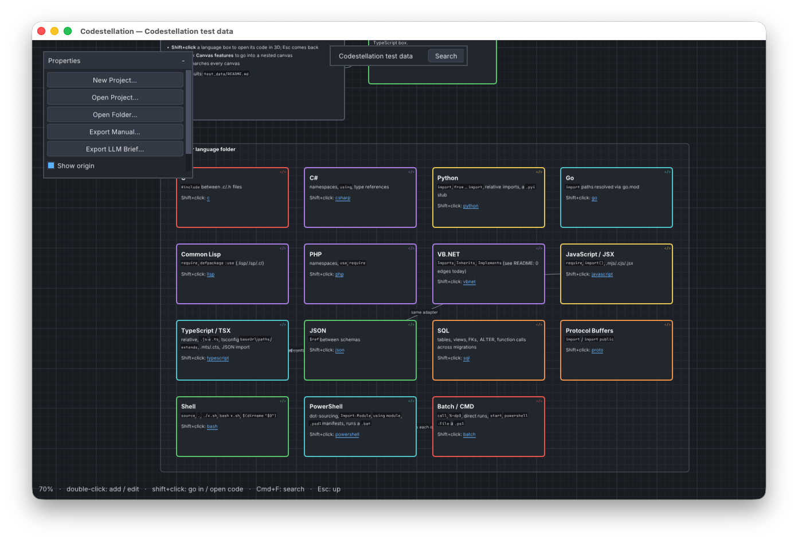
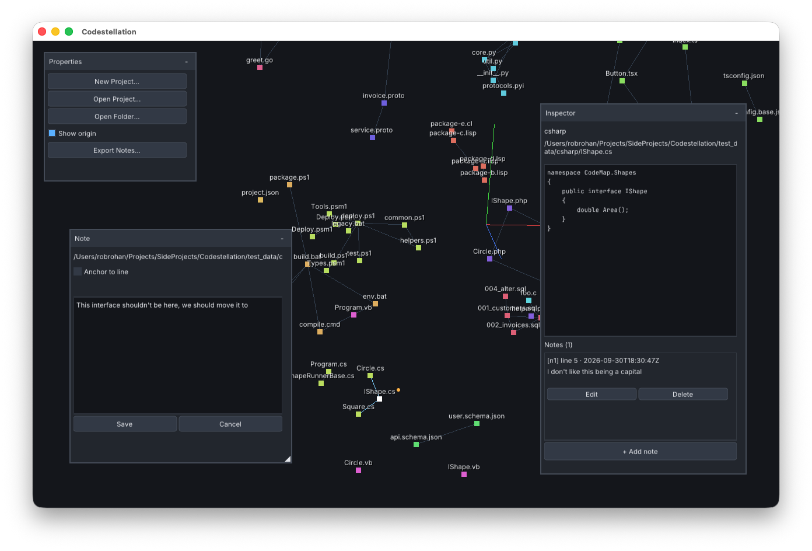

# Codestellation





- [Codestellation](#codestellation)
  - [What is Codestellation](#what-is-codestellation)
  - [Supported languages](#supported-languages)
  - [Build](#build)
    - [Windows and Linux](#windows-and-linux)
    - [macOS Xcode project](#macos-xcode-project)
  - [Run](#run)
  - [Cost Estimates](#cost-estimates)
    - [Humans: COCOMO](#humans-cocomo)
    - [AI: Tokens](#ai-tokens)
    - [Code Value](#code-value)
    - [Groups Don't Add Together](#groups-dont-add-together)
    - [Where Costs are Displayed](#where-costs-are-displayed)
    - [Settings](#settings)


## What is Codestellation

Codestellation helps you map out (or construct) a system using hierarchical abstractions. It is built for digging through unfamiliar, legacy, or "vibe coded" multi-language codebases, as well as starting fresh designs and working through what you are trying to build. The latest verison also does cost estimations based on the linked code.

The canvas view is for multi-level system diagrams. Draw boxes for servers, services, databases, regions, or whatever your system is made of, connect them with labelled lines, and nest them as deep as you like: shift+click a box to go "into it" and diagram _what's in the box_.

You can use a structure like the [C4 model](https://c4model.com) (context, containers, components, code) or make up your own levels. At the leaf of any diagram, a box can point at folders of source code, which opens them in a 3D code view so you can comment on and see the source's structure. It uses a 3D view, because 2D can sometimes [be impossible to navigate](https://www.youtube.com/watch?v=92kcm3b-Q_s).

Every 2D box can have markdown notes, and every file can have notes attached to the overall file or a specific line. The whole project can be exported as a single document to aid in writing a design document or to feed to an LLM to build your creation.

The codestellation view walks a codebase and extracts cross-file dependencies with tree-sitter. It renders the folders as an interactive 3D graph using OpenGL + Nuklear. The formats used are [JSON Canvas](https://jsoncanvas.org) for the 2D box view (the same format Obsidian uses), and the graph files are saved as [NetworkX Node-Link JSON schema](https://networkx.org/en/).

## Supported languages

| Language | Extensions | What links files |
|---|---|---|
| C | `.c` `.h` | `#include` |
| C# | `.cs` | namespace/type declarations, `using`-qualified type references |
| Python | `.py` `.pyi` | `import`, `from ... import`, relative imports |
| Go | `.go` | `import` paths, resolved to packages by directory |
| PHP | `.php` | `require`/`include`; `namespace`, `use`, `extends`, `implements` |
| VB.NET | `.vb` | `Imports` and namespaces (see note) |
| Common Lisp | `.lisp` `.lsp` `.cl` | `in-package`, `require`, `defpackage :use` (see note) |
| JavaScript | `.js` `.mjs` `.cjs` `.jsx` | `import`/`export ... from`, `require()`, dynamic `import()` |
| TypeScript | `.ts` `.mts` `.cts` `.tsx` | as JavaScript, plus tsconfig/jsconfig `baseUrl`, `paths` and `extends` |
| JSON | `.json` | `"$ref"` (JSON Schema / OpenAPI), relative `"extends"` (tsconfig, eslint) |
| SQL | `.sql` | objects made by `CREATE TABLE/VIEW/FUNCTION/...`, used by `FROM`/`JOIN`, `INSERT`/`UPDATE`/`DELETE`, `ALTER`, foreign keys, function calls |
| Protocol Buffers | `.proto` | `import`, `import public` |
| Shell | `.sh` `.bash` | `source` / `.`, `./script.sh`, `bash script.sh`, `$(dirname "$0")/...` |
| PowerShell | `.ps1` `.psm1` `.psd1` | dot-sourcing, `&` and direct runs, `Import-Module` (path, module folder or name), `using module`, `.psd1` manifest entries |
| Batch | `.bat` `.cmd` | `call` (including `%~dp0`), direct runs, `start`, scripts passed to `powershell -File` / `cmd /c` |
| HTML | `.html` `.htm` | `src` / `href` attributes: `<script src>`, `<link href>`, `<a href>`, `<iframe src>` |
| CSS | `.css` | `@import`, and `url(...)` pointing at another stylesheet |
| Markdown | `.md` `.markdown` | `[text](path)` links, `[ref]: path` definitions, Obsidian `[[wiki links]]` and `![[embeds]]` |

Notes:

- **JavaScript / TypeScript:** relative imports resolve like Node, tsc and bundlers (extensions, `index` files, `./x.js` meaning `x.ts`). Bare imports go through the nearest `tsconfig.json`/`jsconfig.json` before counting as packages. TypeScript files can import JSON files.
- **SQL** links by object name, so migrations, views and queries point at the file that created what they use.
- **PowerShell and batch** scripts that call each other are linked. `$PSScriptRoot` and `%~dp0` mean "this script's folder".
- **HTML, CSS and Markdown** links are file paths, so they can point at any file whose adapter declares its path (C, JS/TS, JSON, PHP, Python, shell, and these three). Other sites, `#anchors`, `mailto:` and the like are skipped, as are images, fonts and media. A link starting with `/` is site-root relative; since the root isn't known, it's tried against each folder above the page. Inline `<script>` and `<style>` bodies aren't parsed. A Markdown `[[wiki link]]` finds the nearest note of that name, as Obsidian does.
- **Python, Go and Protocol Buffers** have no in-source module identity, so they match imports by path suffix -- a documented best guess. See the header comments in `src/lang/python/python_adapter.c` and `src/lang/go/go_adapter.c`.
- **VB.NET:** the pinned grammar misparses `Inherits` / `Implements` lines, so base-class and interface links don't appear; `Imports` do. See `src/lang/vbnet/vbnet_adapter.c`.
- **Common Lisp** is a stand-in for an unconfirmed dialect; read the header of `src/lang/lisp/lisp_adapter.c` before trusting it on a real codebase.
- Each adapter's header comment documents exactly what it recognises, and `test_data/` has a small sample project for every language.

The walker skips `node_modules`, `dist`, `.next`, `coverage`, `build`, `vendor` and similar output directories, plus minified `*.min.js` files.

## Build

### Windows and Linux

```
cmake -S . -B build
cmake --build build
```

Fetches tree-sitter, per-language grammars, and GLFW via CMake FetchContent on first configure (the C# grammar's generated parser is large, so that step takes a while). The application is regularly tested on macOS and Windows. It is less tested, but should work fine on Linux.

### macOS Xcode project

```
cmake -G Xcode -B build-xcode -S .
open build-xcode/Codestellation.xcodeproj
```

`build-xcode/` is gitignored. Xcode is a multi-config generator, so don't pass `-DCMAKE_BUILD_TYPE` -- pick the configuration in Xcode, or build from the CLI with `cmake --build build-xcode --config Debug`. Editing `CMakeLists.txt` re-runs CMake automatically on the next build via the generated `ZERO_CHECK` target.

This produces an ad-hoc-signed `Codestellation.app` that runs straight from Xcode's Run button. Hardened runtime is deliberately off here, since it refuses the `DYLD_*` injection Xcode's debugger relies on. To build a release, you have to configure all that by hand in Xcode.

The Xcode build is universal (Apple Silicon + Intel) and targets macOS 12.0, the oldest Xcode 27 supports (override with `-DCMAKE_OSX_ARCHITECTURES=...` / `-DCMAKE_OSX_DEPLOYMENT_TARGET=...`).
A `build-xcode/` configured before these defaults existed keeps its old cached target (the build machine's macOS), so pass `-DCMAKE_OSX_DEPLOYMENT_TARGET=12.0` once, or delete the folder and reconfigure. The app icon is `resources/macos/Codestellation.icns`, generated by `scripts/make_icon.py` (needs numpy).

## Run

```
./build/src/codemap-view                       # then use the Properties panel
./build/src/codemap-view path/to/project.json  # open a system-map project
./build/src/codemap-view graph.json            # or a previously built graph
```

Stats are worked out when the graph is built, so a `graph.json` from an older build shows a note to reopen the folder instead.

With nothing selected, the Inspector shows an **Overview** of the whole graph: file and dependency counts and the cost of all its code. You can select several files (Cmd/Ctrl+right-click) to see their combined cost or add a note about the group.

Optional sanity check of a built graph (needs networkx), pointed at the cached `graph.json` in the project's _~/Library/Application Support/Codestellation/_ folder:

```bash
python3 scripts/sanity_check.py graph.json
```

## Cost Estimates

Codestellation prices code in two ways, as rough guides to what it would cost a team of humans to produce, and as if an AI was prompted to write the code. These values should be considered ballpark figures. The costing models used are not for doing quotes. They were created in the 1980s in larger corporations, but at least it's something.

The mix of the human model and the AI token model leads to a third figure, the **value**, which blends the two by how much of the code was written by AI vs. written by human. Again, take these values with a grain of salt.

Only code lines are used in the calculation. Lines that are blank or only comments are ignored. As are Markdown and JSON files.

### Humans: COCOMO

Based on the [Basic COCOMO (Boehm, 1981)](https://link.springer.com/article/10.1007/BF02249046). We are using the same model and defaults as [scc](https://github.com/boyter/scc) and sloccount:

```
effort   = a × KSLOC^b          person-months
schedule = c × effort^d         months
people   = effort ÷ schedule
cost     = effort × (salary ÷ 12) × overhead
```

It's often helpful to look up a senior developer salary in your area for the base salary of one person, and the **overhead** is a multiplier to the salary that should bring the value up to what a developer actually costs: benefits, taxes, office, equipment, management. 1.0 is salary only (contractors for example), about 1.3-1.5 is typical in-house staff. The default, 2.4, is fully loaded developer.

The mode setting controls some parameters that should match your environment:

| Mode | a | b | c | d | For |
|---|---|---|---|---|---|
| organic (default) | 2.4 | 1.05 | 2.5 | 0.38 | small teams on familiar problems |
| semi-detached | 3.0 | 1.12 | 2.5 | 0.35 | in between |
| embedded | 3.6 | 1.20 | 2.5 | 0.32 | tight hardware, process or regulatory constraints |

The _Person-months_ value show how much work the code represents for a typical team of the kind the model was calibrated on, including design, testing and coordination. It isn't how long it actually took. One person working with modern tools will usually beat the estimated time, so read it as an upper bound for solo hand written code. Don't fall into the "if it takes one woman 9 months to make a baby, then it should take 9 women one month" trap.

### AI: Tokens

The AI calculation doesn't touch the COCOMO figure directly.

```
tokens kept  = characters ÷ chars_per_token
multiplier   = reasoning_multiplier × complexity factor × size factor
tokens spent = tokens kept × multiplier
cost         = tokens spent ÷ 1,000,000 × token_price
```

The token count in the finished code are only a floor. Using AI to produce code means reading context, reasoning, and tool calling. Those values don't get counted by just estimating the number of tokens in the code (which is just a guess anyway); the **reasoning multiplier** stands for all of that. Its default of 300 which is a best guess (about 3¢ a line at the default price). Two factors to can change the value:

- **Complexity factor**: decision points per code line, against a typical 0.2 (roughly the median across a spread of real projects), clamped to 0.5x–2x. Code that branches more often takes more reasoning per line. Files in languages without complexity count as typical.
- **Size factor**: `1 + 0.5 × log10(KSLOC)`, at least 1: 1x at 1k lines, 1.5x at 10k, 2x at 100k. Longer code means more context to read for each change.

The default price, $10 per million tokens, is Claude Sonnet 5.5's output rate as of October 2026. Most tokens an agent spends are cheaper input and cache reads, which the multiplier absorbs. Obviously add your own price if you know it.

### Code Value

```
value = COCOMO (cost of the hand-written lines) + AI share × AI cost
```

where the hand-written lines are `(1 − ai_share) x code lines`. At 0% AI the value is just the human cost.

### Groups Don't Add Together

Both models grow faster than the code does, so a set of files is priced by adding up its lines, characters and complexity and estimating once, never by adding per-file estimates. One file's cost is a rough indication of what that piece is worth, not a project estimate.

### Where Costs are Displayed

- **Inspector**: per file in Stats; for several selected files; for the whole graph in the Overview when nothing is selected.
- **Canvas**: each box with code behind it shows its lines and value in its bottom-right corner. That covers the box's own folders plus everything on the canvases it links to, all the way down. A line at the bottom show the whole canvas total. Each file counts once, however many boxes reach it. Code that hasn't been opened in the 3D view yet has no built graph to count. There is a status on the box if it hasn't been included.
- **Export**: an "Estimated cost" section for the whole map, and a Size line in each box's code summary.

### Settings

Are in the project's `project.json`, under `cost`:

```json
"cost": {
  "currency": "$",
  "salary": 56286,
  "overhead": 2.4,
  "mode": "organic",
  "ai_share": 0,
  "token_price": 10,
  "reasoning_multiplier": 300,
  "chars_per_token": 4
}
```

| Key | Meaning | Default |
|---|---|---|
| `currency` | Prefix for amounts, e.g. `"€"` or `"EUR "` | `"$"` |
| `salary` | Per developer per year | 56286 |
| `overhead` | Multiplier on salary | 2.4 |
| `mode` | `organic`, `semi-detached` or `embedded` | `organic` |
| `ai_share` | Fraction of the code written by AI, 0–1 | 0 |
| `token_price` | Per million tokens | 10 |
| `reasoning_multiplier` | Tokens spent per token kept, before scaling | 300 |
| `chars_per_token` | Characters per token | 4 |

Everything except `currency` and `chars_per_token` can also be changed in the Properties panel while a project is open.

New projects get the block with defaults. Older projects use the defaults until a setting is changed. Opening a plain folder, the 3D view directly (aka no project), always uses the defaults.
